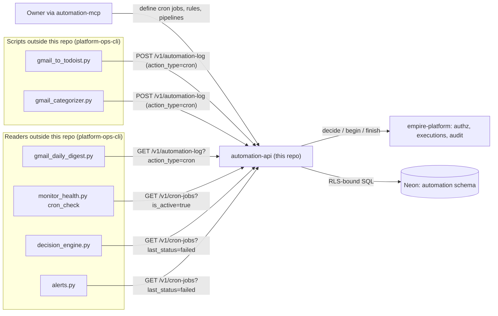
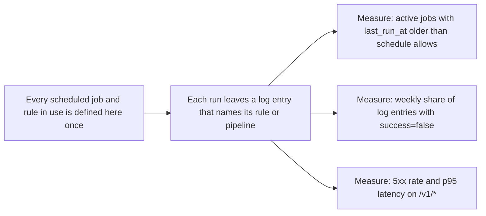

# 01 — Business process (As-Is / To-Be)

Automation cell เก็บ **นิยาม** ของงานอัตโนมัติ (cron job, automation rule, workflow pipeline) และ **log** ของแต่ละรอบการทำงาน
ตัว cell เองไม่รัน job ไม่ evaluate rule และไม่ execute pipeline (`PRODUCT.md` "Out of scope") — งานจริงรันที่อื่น แล้วเขียน log กลับมาที่นี่

## As-Is (จากโค้ดวันนี้)

ขั้นตอนหลัก:

1. Owner (หรือ agent ผ่าน MCP) สร้าง/แก้นิยาม cron job, rule, pipeline ผ่าน `/v1/*`
2. Script ภายนอกที่รันงานเสร็จ เขียน `automation-log` หนึ่งแถวต่อรอบ (เช่น Gmail→Todoist, Gmail categorizer) แบบ best-effort (`except Exception: pass`)
3. Report/alert scripts อ่าน `cron-jobs` ที่ `last_status=failed` และ log ของวันก่อน เพื่อสรุปหรือแจ้งเตือน
4. ทุกการอ่านถาม `empire-platform /v1/authz/decide`; ทุกการเขียนเปิด execution บน platform แล้ว finish พร้อม row hash

ข้อเท็จจริงจาก central docs: `CRON-DAG.md` บันทึกว่า local `cron_runner.py` / `cron_registry.py` ถูกลบ 2026-10-11 และ "none of the 40 local jobs ever ran" ใน history ของ cell นี้ — งาน scheduled ย้ายไป Railway cron ของ cell เจ้าของ

Sources: `PRODUCT.md`, `README.md`, `cell.yaml`, `src/cellkit/app.py`, `src/cellkit/platform.py`,
platform-ops-cli@0880abe `infra/scripts/sync/gmail_to_todoist.py`, `infra/scripts/sync/gmail_categorizer.py`, `infra/scripts/sync/gmail_daily_digest.py`,
`infra/scripts/platform/monitor_health.py`, `infra/scripts/workflows/decision_engine.py`, `infra/scripts/utils/alerts.py`,
[architecture-docs CRON-DAG.md](https://github.com/bookchaowalit/architecture-docs/blob/main/docs/architecture/CRON-DAG.md)

## To-Be

แหล่ง To-Be ที่มีใน repo: `PRODUCT.md` ("Success" และ "Measures — Proposed") และ `DOCPACK/00-product-card.md` §8 เท่านั้น ไม่มี `docs/UPGRADE-PLAN.md` และ `specs/001-l2-baseline` ไม่เปลี่ยน behaviour

Sources: `PRODUCT.md` (Product Purpose, Measures), `DOCPACK/00-product-card.md`

## Open questions

- Runner ตัวไหนอ่านนิยาม `cron-jobs` จาก cell นี้จริงแล้วรันตาม `schedule`? (`PRODUCT.md` Users: "[ต้องยืนยัน]"; ไม่พบ caller ที่อ่าน `schedule` ใน ops-cli ที่อ่านมา)
- Script ใน ops-cli ที่เขียน log รันที่ไหนและเมื่อไร (Railway cron, local timer, GitHub Actions)? ไม่ได้อยู่ใน repo นี้
- Log ที่เขียนจาก ops-cli ไม่ใส่ `rule_id` / `pipeline_id` ซึ่งขัดกับเป้า "names its rule or pipeline" — จะบังคับหรือไม่
