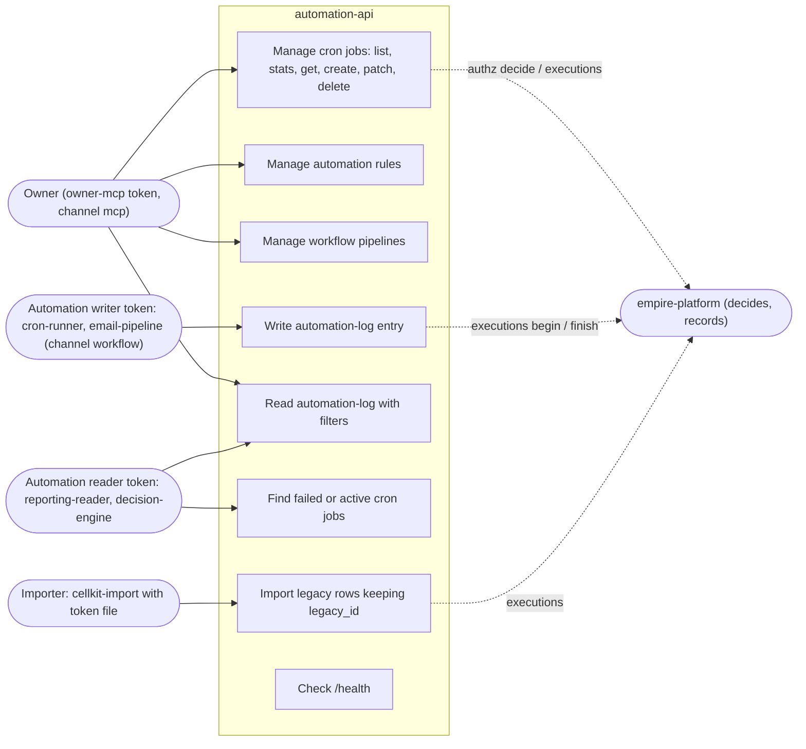

# 02 — Use cases

Actors คือผู้ถือ token ที่ `empire-platform` ออกให้ (RS256, audience `automation-api`) แยกตาม permission
`automation.<resource>:read|write|delete` (`Cell.permissions()` ใน `src/cellkit/spec.py`) และ channel (`api`, `mcp`, `workflow`, `cli`, `event` ใน `src/cellkit/auth.py`)
ใน code ไม่มี role แบบ admin/user แยก — สิทธิ์ทั้งหมดตัดสินโดย platform `/v1/authz/decide`

| Actor | Permission ที่ใช้ | หลักฐาน |
|---|---|---|
| Owner ผ่าน `automation-mcp` | `automation.*:read/write/delete` ตามที่ platform ให้ | `src/cellkit/mcp.py` (default automation `owner-mcp`), `.mcp.json` |
| `cron-runner`, `email-pipeline` | `automation.automation-log:write` | platform-ops-cli `gmail_to_todoist.py`, `gmail_categorizer.py` |
| `reporting-reader`, `decision-engine` | `automation.cron-job:read`, `automation.automation-log:read` | platform-ops-cli `monitor_health.py`, `alerts.py`, `gmail_daily_digest.py`, `decision_engine.py` |
| Importer | write ทุก resource พร้อม `legacy_id` | `src/cellkit/importer.py` |
| Uptime monitor | ไม่มี token, `GET /health` | platform-uptime-worker `src/targets.ts` |

Sources: `src/cellkit/auth.py`, `src/cellkit/spec.py`, `src/cellkit/app.py`, `src/cellkit/mcp.py`, `src/cellkit/importer.py`, `.mcp.json`, `PRODUCT.md`,
platform-ops-cli@0880abe `infra/scripts/**` (ไฟล์ที่ระบุในตาราง), platform-uptime-worker@57f0afb `src/targets.ts`

## Open questions

- Grant จริงของแต่ละ automation token (`cron-runner`, `email-pipeline`, `reporting-reader`, `decision-engine`) อยู่ใน empire-platform ไม่ได้อยู่ใน repo นี้ จึงยืนยันขอบเขตสิทธิ์ไม่ได้
