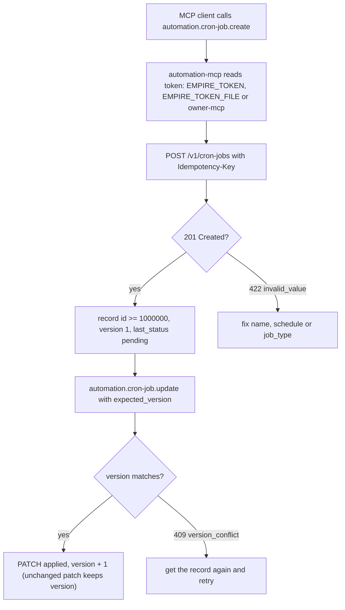
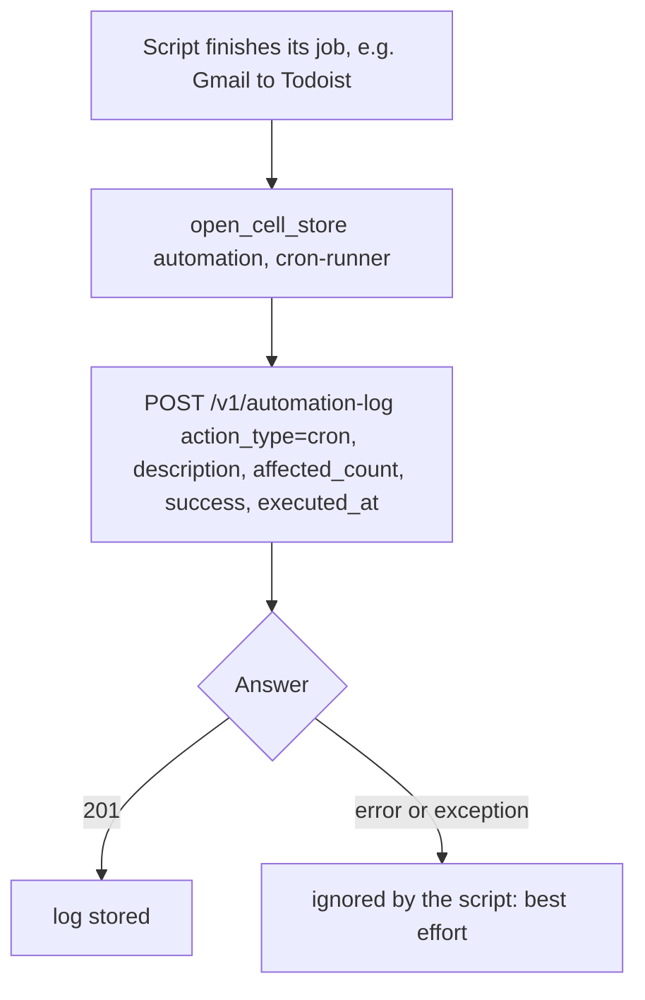
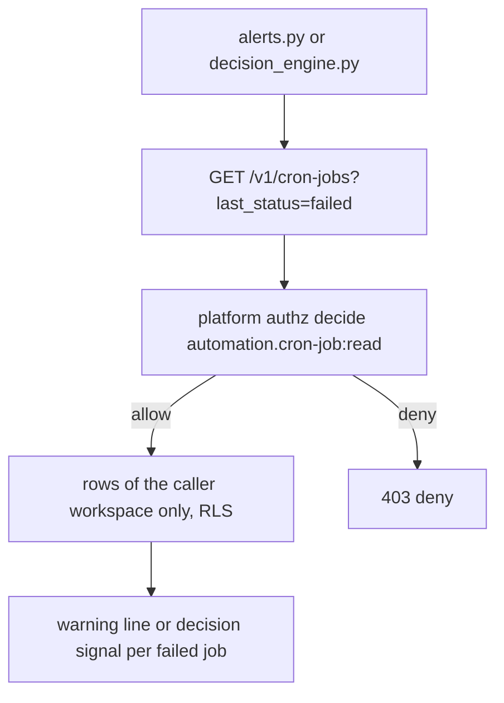
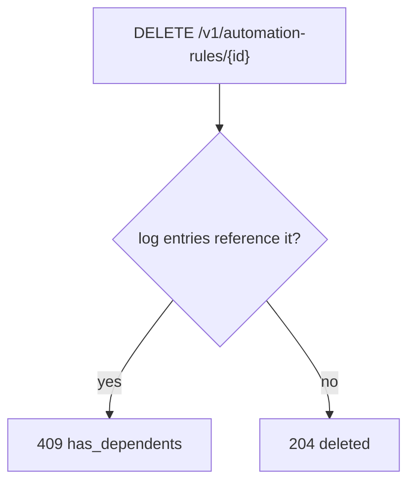

# 03 — User flows

API อย่างเดียว ไม่มีหน้าเว็บ (`PRODUCT.md` Platform = `api`) — flow ด้านล่างคือ journey ต่อ actor ผ่าน routes ของ `src/cellkit/app.py` และ MCP tools ของ `src/cellkit/mcp.py`

## Owner: กำหนด cron job แล้วแก้ไข (ผ่าน MCP)

## Runner script: เขียน log หลังรันงาน

## Reader: หา job ที่ล้มเหลว

## Rule / pipeline ที่มี log ผูกอยู่

Sources: `src/cellkit/app.py` (routes, `write`, error codes), `src/cellkit/mcp.py`, `cell.yaml`, `tests/test_automation_defaults.py`, `tests/test_automation_queries.py`,
platform-ops-cli@0880abe `infra/scripts/sync/gmail_to_todoist.py`, `infra/scripts/utils/alerts.py`, `infra/scripts/workflows/decision_engine.py`

## Open questions

- ไม่มี flow "runner อ่าน cron-job แล้วอัปเดต `last_run_at` / `last_status`" ใน caller ที่พบ — ใครอัปเดตฟิลด์เหล่านี้?
