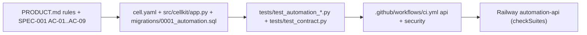

# 04 — Traceability (RTM)

Requirement มาจาก `PRODUCT.md` (Capabilities and Constraints) และ `specs/001-l2-baseline/spec.md` (AC-01…AC-09)
Release path เดียวกันทุกแถว: `.github/workflows/ci.yml` (jobs `api`, `security`) → Railway Wait for CI → `automation-api`

| Req | Requirement | Code | Test | Release |
|---|---|---|---|---|
| AC-01 | cron job ต้องมี `name`, `schedule`, `job_type` | `cell.yaml` cron-job, `migrations/0001_automation.sql` CHECK | `tests/test_automation_validation.py::test_a_cron_job_needs_a_name_a_schedule_and_a_job_type` | ci.yml `api` |
| AC-02 | counter ห้ามติดลบ | `cell.yaml` `min: 0`, migration CHECK `>= 0` | `test_retry_count_cannot_be_negative`, `test_rule_execution_count_cannot_be_negative`, `test_pipeline_run_count_cannot_be_negative`, `test_log_affected_count_cannot_be_negative` | ci.yml `api` |
| AC-03 | log ชี้ rule/pipeline ที่ไม่มีหรือข้าม workspace ไม่ได้ (422 `reference_not_found`) | migration FK `(workspace_id, rule_id)`, `app.py` ForeignKeyViolation handler | `test_a_log_entry_cannot_point_at_another_workspaces_rule`, `test_a_log_entry_cannot_point_at_a_missing_rule_or_pipeline` | ci.yml `api` |
| AC-04 | rule ที่มี log ลบไม่ได้ (409 `has_dependents`) | migration FK, `app.py` | `tests/test_automation_defaults.py::test_a_rule_with_log_entries_cannot_be_deleted` | ci.yml `api` |
| AC-05 | default: active, pending, retry 0, params `{}` | `cell.yaml` defaults, migration DEFAULT | `test_new_cron_job_is_active_pending_with_no_retries` | ci.yml `api` |
| AC-06 | import คง id และ timestamps; import ซ้ำ 409 | `app.py` create (`legacy_id`), unique index `*_legacy` | `test_an_import_keeps_its_old_id_and_timestamps`, `test_a_repeated_import_conflicts_instead_of_duplicating` | ci.yml `api` |
| AC-07 | list/stats ตาม filter ที่ประกาศ | `cell.yaml` `filters`, `app.py` `where`, `stats` | `tests/test_automation_queries.py::test_stats_count_cron_jobs_per_job_type`, `test_stats_refuse_a_field_that_is_not_a_filter` | ci.yml `api` |
| AC-08 | patch bump version; patch ไม่เปลี่ยนไม่ bump; stale version 409 | `app.py` update, `changed` | `test_recording_a_run_bumps_the_version`, `test_a_patch_that_changes_nothing_keeps_the_version`, `test_a_stale_expected_version_is_refused` | ci.yml `api` |
| AC-09 | ตัวเลขต้องพอดี column, ไม่รับ NaN/Infinity | `app.py` `_constraints`, `invalid_request` | `tests/test_contract.py` → `src/cellkit/contract.py::test_numbers_fit_their_columns` | ci.yml `api` |
| P-1 | Authorization, workspace isolation, idempotent create | `app.py` `allow`, `write`, `reserve`; migration RLS | `src/cellkit/contract.py` `test_authorization`, `test_workspace_isolation`, `test_idempotent_create` | ci.yml `api` |
| P-2 | Sentry ไม่ส่งข้อมูลอ่อนไหว | `src/cellkit/_sentry.py` | `tests/test_sentry.py` (8 tests) | ci.yml `api` |
| P-3 | Dependency / code security scan | — | — | ci.yml `security` (shared workflow) |
| P-4 | MCP tools ตรงกับ API, ไม่มี identity args | `src/cellkit/mcp.py` | **gap: ไม่มี test ของ MCP ใน `tests/`** | — |

Sources: `PRODUCT.md`, `specs/001-l2-baseline/spec.md`, `cell.yaml`, `migrations/0001_automation.sql`, `src/cellkit/app.py`, `src/cellkit/contract.py`, `src/cellkit/mcp.py`, `src/cellkit/_sentry.py`, `tests/*.py`, `.github/workflows/ci.yml`, `.railway/railway.ts`

## Open questions

- SPEC-001 review 2026-10-24 "changes requested": ข้อความเรื่อง `ranges` ไม่ตรงกับ `cell.yaml` (ไม่มี ranges) และ AC-08 ส่วน unchanged patch ทดสอบบน rule ไม่ใช่ cron job — ยังไม่แก้
- SPEC-001 ยังรอ owner approve
