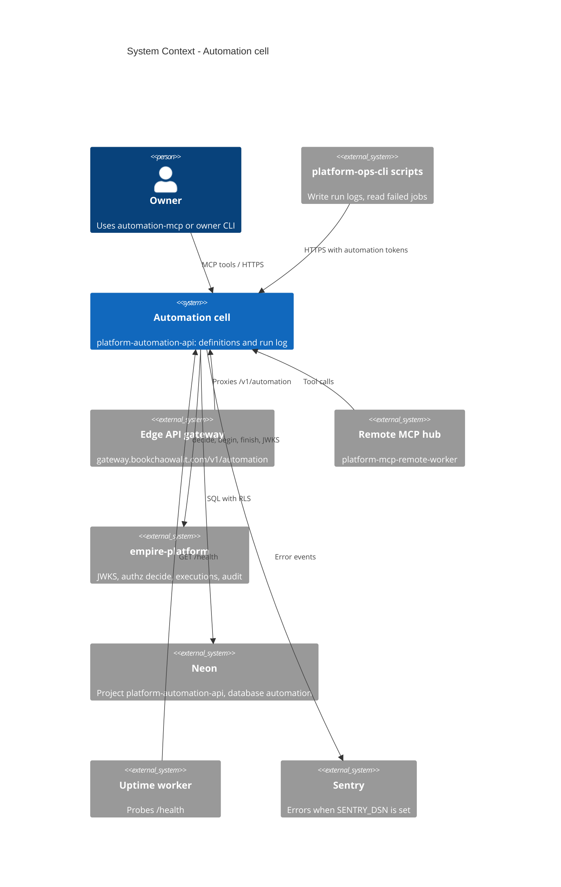

# 05 — C4 Context

Sources: `README.md`, `PRODUCT.md`, `src/cellkit/platform.py`, `src/cellkit/auth.py`, `src/cellkit/db.py`, `src/cellkit/_sentry.py`, `src/cellkit/mcp.py`,
platform-api-gateway@1f02c2a `routes.json`, platform-mcp-remote-worker@eb10b4d `src/worker.ts` (CELL_HOSTS), platform-uptime-worker@57f0afb `src/targets.ts`,
platform-ops-cli@0880abe `infra/scripts/utils/cell_store.py`, ops record: api-gateway-edge (2026-11-03)

## Open questions

- Gateway ส่งต่อ token ของ caller ตรงไปยัง cell หรือไม่ (cell ตรวจ RS256 เองทุกครั้ง) — ไม่ได้อ่าน gateway code ส่วน forward ใน pack นี้
