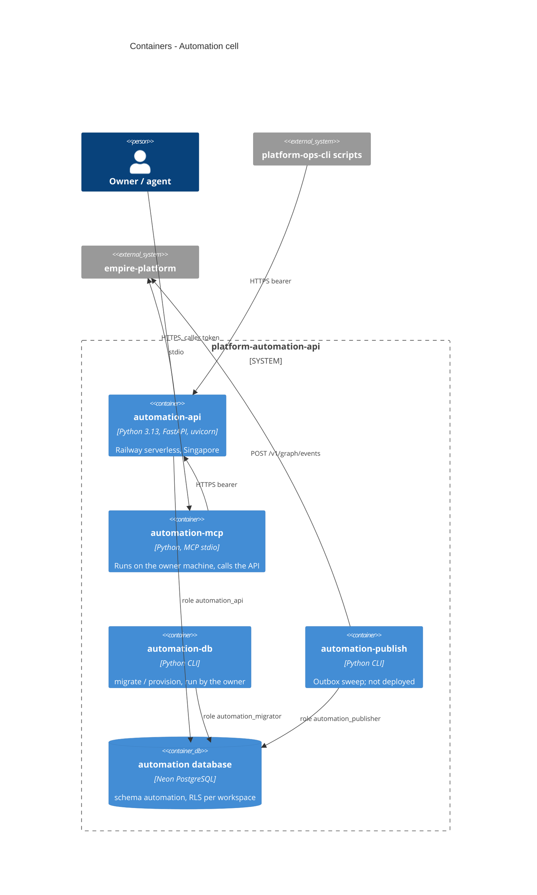

# 06 — C4 Container

Image เดียว (`Dockerfile`, CMD `automation-api`) แต่ `pyproject.toml` ประกาศ entry points 4 ตัว: `automation-api`, `automation-publish`, `automation-db`, `automation-mcp`
บน Railway มี service เดียวคือ `automation-api` (`.railway/railway.ts`) — ไม่มี publisher cron service

Sources: `Dockerfile`, `pyproject.toml` (`[project.scripts]`), `.railway/railway.ts`, `.mcp.json`, `src/cellkit/server.py`, `src/cellkit/db.py`, `src/cellkit/publisher.py`, `db/roles.sql`, `migrations/0001_automation.sql`

## Open questions

- `automation-publish` ไม่มีที่รัน และไม่มี resource ใดประกาศ `graph` ใน `cell.yaml` จึงไม่มี outbox row — จะลบออกหรือคงไว้เป็น inert code (`docs/cellkit-notes.md` บอกว่า inert)
