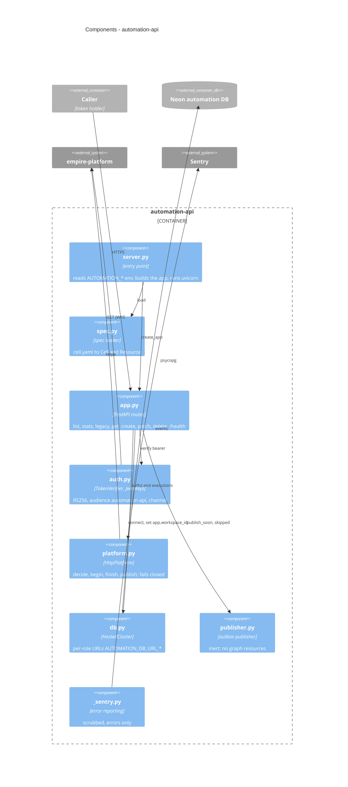

# 07 — C4 Component (automation-api)

`src/solo_automation/` ว่าง (มีแค่ `__init__.py`) และ `cell.yaml` ไม่มี `extend` — ทุก route มาจาก generic `cellkit`

Sources: `src/cellkit/server.py`, `src/cellkit/spec.py`, `src/cellkit/app.py`, `src/cellkit/auth.py`, `src/cellkit/platform.py`, `src/cellkit/db.py`, `src/cellkit/publisher.py`, `src/cellkit/_sentry.py`, `src/solo_automation/__init__.py`, `cell.yaml`

## Open questions

- Production ตั้ง `AUTOMATION_JWT_JWKS_URL` แล้วหรือยัง? README ระบุเฉพาะ `AUTOMATION_JWT_PUBLIC_KEY_PEM` (pinned key) — ถ้าไม่มี JWKS URL, `JwksKeys` จะไม่ถูกใช้
