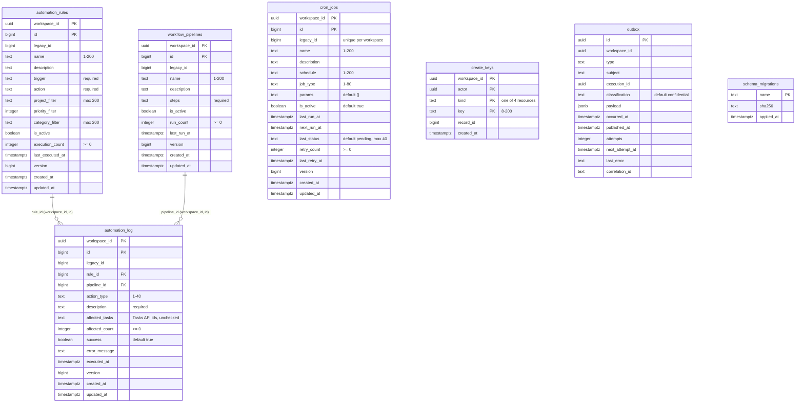

# 09 — ERD

Schema `automation` จาก `migrations/0001_automation.sql` (migration เดียว) + ตาราง `public.schema_migrations` ที่ `automation-db migrate` สร้าง
ทุกตาราง PK เป็น `(workspace_id, id)` ยกเว้น `create_keys` และ `outbox`; id เริ่มที่ 1,000,000 (ช่วงต่ำกว่าสงวนให้ `legacy_id` import)

หมายเหตุ:
- `create_keys.record_id` ไม่มี FK (จองไว้ก่อน execution เริ่ม)
- `outbox` ไม่มีแถวในเซลล์นี้: ไม่มี resource ไหนประกาศ `graph` ใน `cell.yaml`
- `affected_tasks` อ้าง Tasks API แบบ free text ไม่มี FK ข้าม service (`PRODUCT.md`)
- Indexes: `*_legacy` (unique partial), และ index ต่อ filter field ใน `cell.yaml`

Sources: `migrations/0001_automation.sql`, `cell.yaml`, `src/cellkit/db.py` (`migrate`), `src/cellkit/app.py` (`emit`, `reserve`), `PRODUCT.md`
