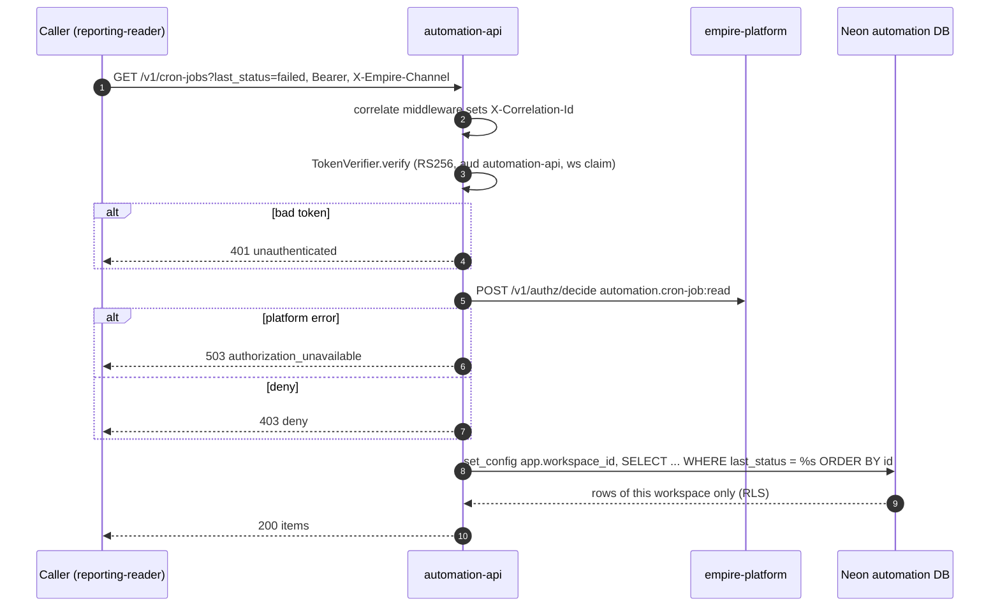
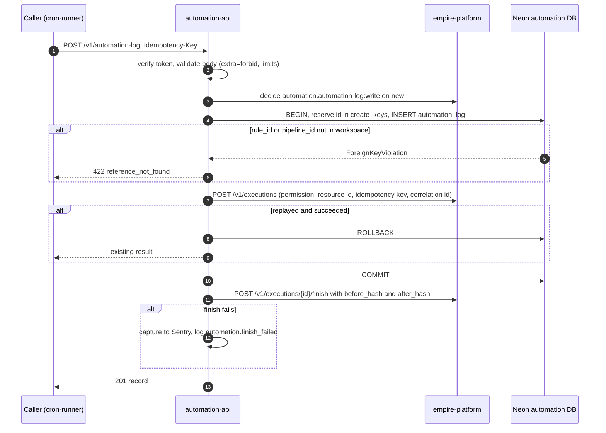
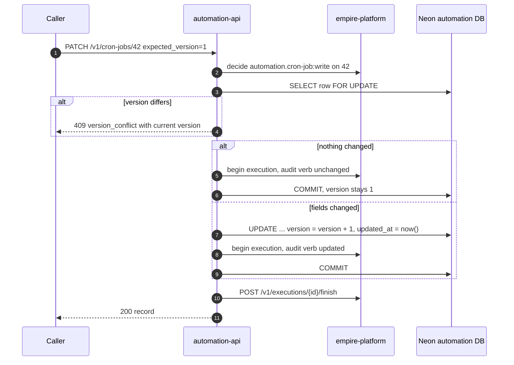
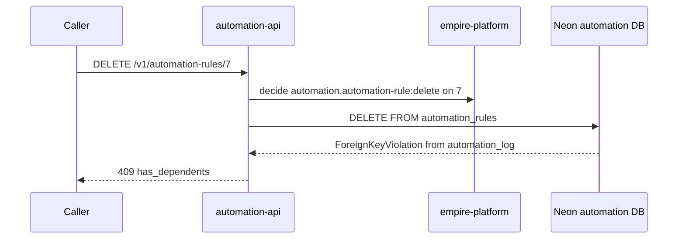

# 10 — Sequences

## 1. Read: `GET /v1/cron-jobs?last_status=failed`

## 2. Create: `POST /v1/automation-log` (Idempotency-Key)

## 3. Update: `PATCH /v1/cron-jobs/{id}` with `expected_version`

## 4. Delete a rule that has log entries

Sources: `src/cellkit/app.py` (`correlate`, `principal`, `allow`, `write`, `reserve`, `register`), `src/cellkit/auth.py`, `src/cellkit/platform.py`, `migrations/0001_automation.sql`,
`tests/test_automation_defaults.py`, `tests/test_automation_queries.py`, platform-ops-cli@0880abe `infra/scripts/sync/gmail_to_todoist.py`
