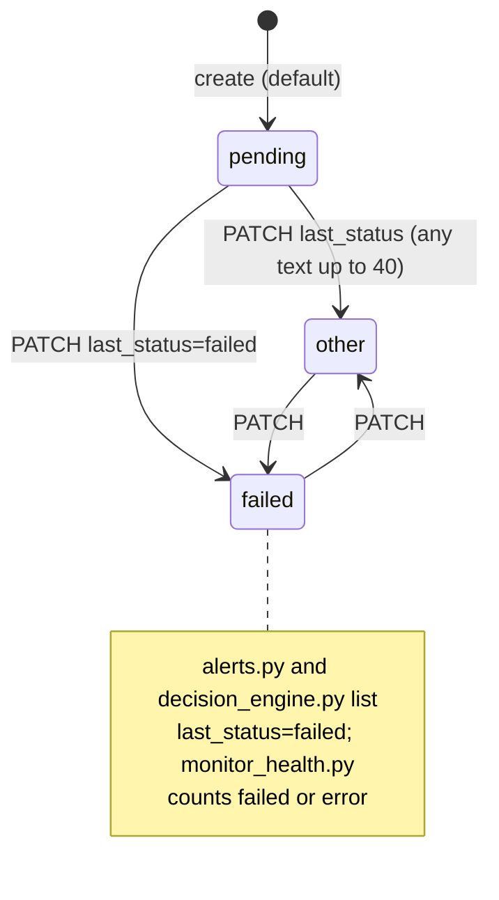
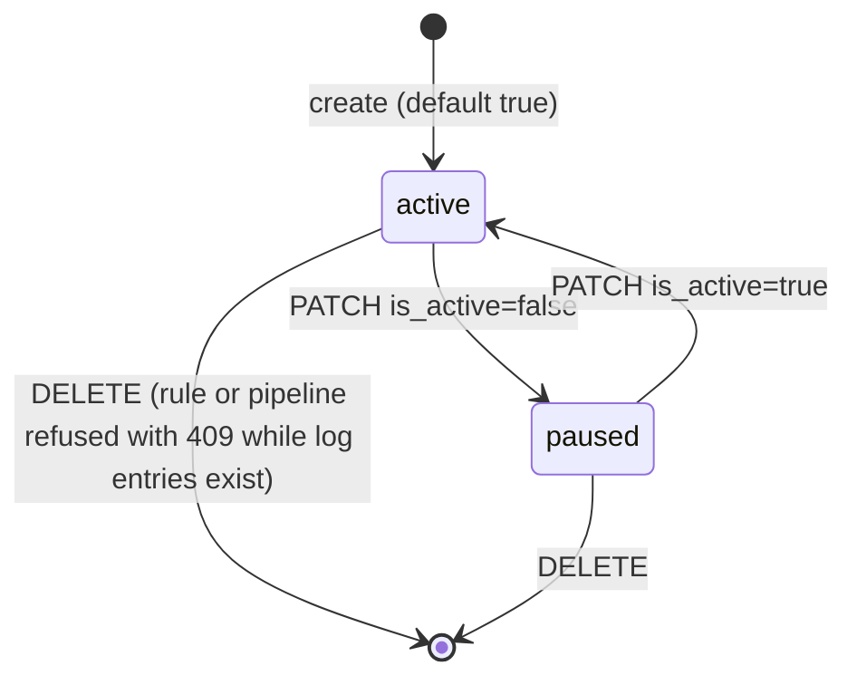
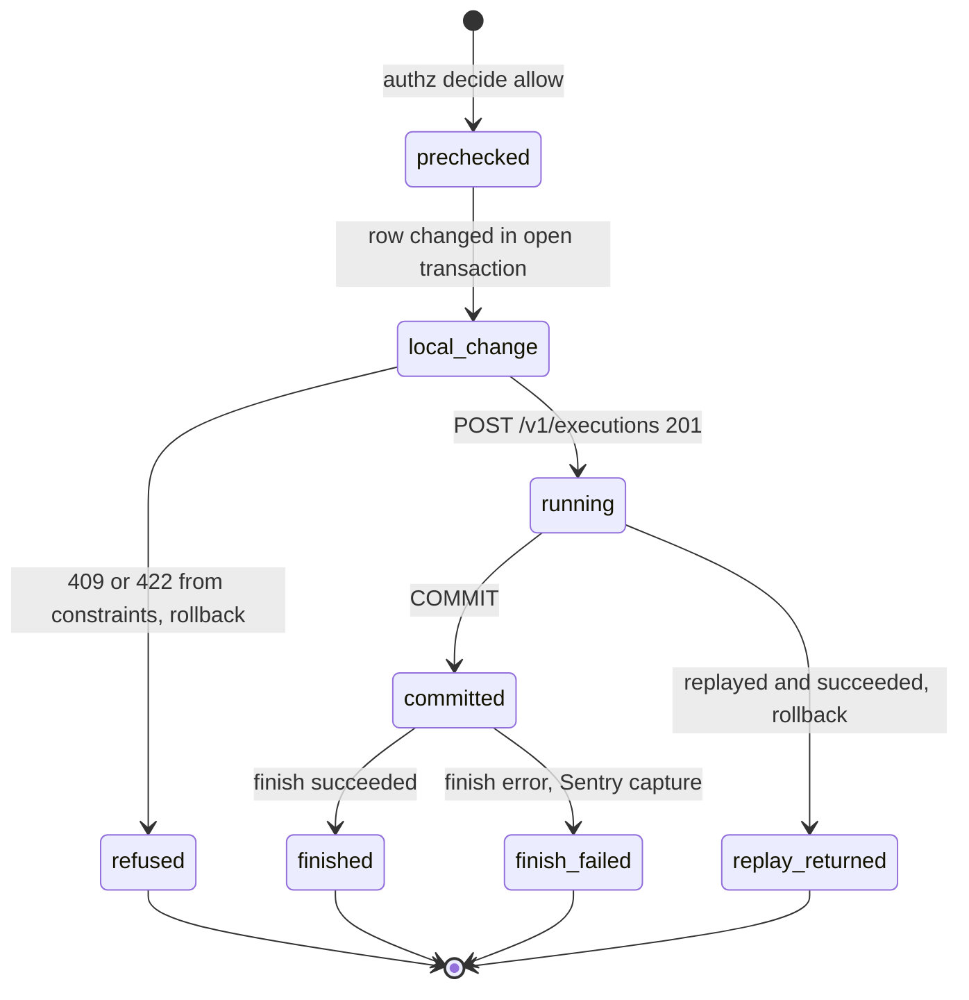
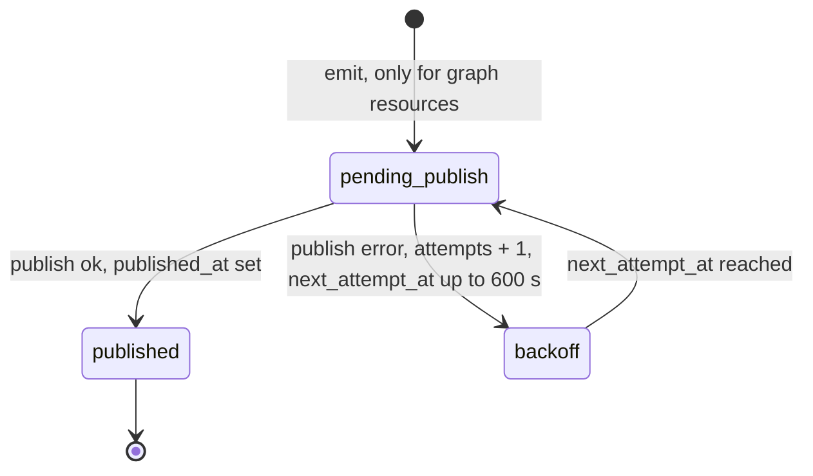

# 11 — State machines

ไม่มี enum หรือ transition rule ในโค้ด: `last_status`, `job_type`, `action_type` เป็น free text (`PRODUCT.md`) — API ไม่บังคับลำดับสถานะ
สิ่งที่ code บังคับจริงคือ default, flag `is_active`, version และ lifecycle ของ write execution

## cron_jobs.last_status (ค่าที่โค้ดรู้จัก)

ค่า `pending` เป็น default ใน `cell.yaml`/migration; ค่า `failed` และ `error` คือค่าที่ readers ใน platform-ops-cli ใช้กรอง/นับ ไม่มีค่าอื่นที่ถูกอ้างในโค้ด

## is_active (cron_jobs, automation_rules, workflow_pipelines)

## Write execution (ทุก resource)

## outbox row (inert in this cell)

Sources: `cell.yaml`, `migrations/0001_automation.sql`, `PRODUCT.md`, `src/cellkit/app.py` (`write`, `emit`, update/delete), `src/cellkit/publisher.py`,
platform-ops-cli@0880abe `infra/scripts/utils/alerts.py`, `infra/scripts/workflows/decision_engine.py`, `infra/scripts/platform/monitor_health.py`

## Open questions

- ชุดค่า `last_status` ที่ runner ใช้จริงคืออะไร (เช่น `success`, `running`)? ควรเป็น enum หรือไม่
