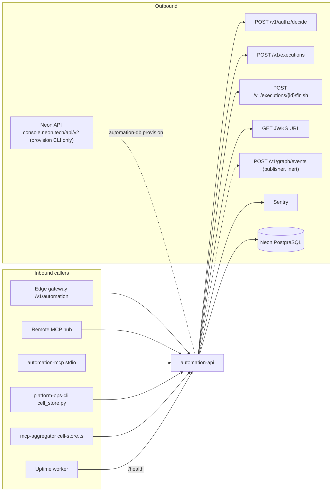

# 12 — API and integrations

## Endpoints (ต่อ resource, จาก `register()` ใน `src/cellkit/app.py`)

| Method | Path | Permission | หมายเหตุ |
|---|---|---|---|
| GET | `/v1/{plural}` | `automation.{resource}:read` | filters ตาม `cell.yaml`, `id`, `legacy_id`, `updated_since`, `null`, `order`, `after_id`, `limit` (default 100), `offset` |
| GET | `/v1/{plural}/stats` | read | group by หนึ่ง filter field เท่านั้น |
| GET | `/v1/{plural}/legacy/{legacy_id}` | read | |
| GET | `/v1/{plural}/{id}` | read | |
| POST | `/v1/{plural}` | `:write` | `Idempotency-Key` (8–200), `legacy_id` สำหรับ import, 201 |
| PATCH | `/v1/{plural}/{id}` | `:write` | `expected_version` |
| DELETE | `/v1/{plural}/{id}` | `:delete` | 204 |
| GET | `/health` | ไม่มี auth | `{"status": "ok"}` |

`{plural}` = `cron-jobs`, `automation-rules`, `workflow-pipelines`, `automation-log` · Headers: `Authorization: Bearer`, `X-Empire-Channel`, `X-Correlation-Id` (echo กลับทุก response)
MCP: `automation.<resource>.list|get|create|update|delete` → endpoint เดียวกัน (`src/cellkit/mcp.py`)

## Integrations

Error vocabulary: 401 `unauthenticated`, 403 `deny`, 404 `not_found`, 409 `conflict` / `version_conflict` / `has_dependents` / `replayed` / `replayed_record_gone`, 422 `invalid_value` / `reference_not_found`, 503 `unavailable` / `authorization_unavailable`
ไม่มี webhook ขาเข้าหรือ third-party SDK อื่นนอกจาก `sentry-sdk`

Sources: `src/cellkit/app.py`, `src/cellkit/platform.py`, `src/cellkit/auth.py`, `src/cellkit/mcp.py`, `src/cellkit/db.py` (`NEON_API`), `src/cellkit/publisher.py`, `README.md`, `pyproject.toml`,
platform-api-gateway@1f02c2a `routes.json`, platform-mcp-remote-worker@eb10b4d `src/worker.ts`, platform-ops-cli@0880abe `infra/scripts/utils/cell_store.py`, platform-mcp-aggregator@336bcea `src/cell-store.ts`, platform-uptime-worker@57f0afb `src/targets.ts`

## Open questions

- ไม่มี OpenAPI ที่ commit ไว้; FastAPI สร้าง `/openapi.json` อัตโนมัติ (gateway มี tokenless path สำหรับ `describe_cell` ตาม ops record api-gateway-edge) — ควร publish contract หรือไม่
