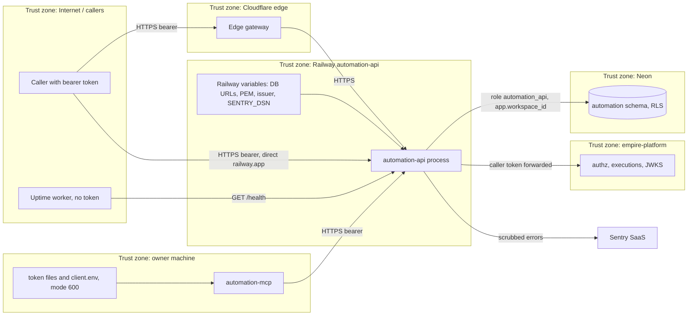

# 13 — Threat model (DFD + STRIDE)

## STRIDE

| Element | Threat | Mitigation ที่พบในโค้ด | Gap |
|---|---|---|---|
| Caller → API | **S** token ปลอม / audience อื่น | RS256 เท่านั้น, `audience=automation-api`, `issuer`, require `exp/iat/sub/jti`, `ws` claim; owner token ≤ 3600 s, delegated ≤ 30 d (`auth.py`) | ไม่มี revocation check ฝั่ง cell (พึ่ง platform decide ทุก request) |
| Caller → API | **S** dev issuer ใน prod | `hosted mode refuses the dev issuer` (`server.py`) | — |
| API | **T** แก้แถวข้าม workspace | RLS `FORCE` + policy, FK `(workspace_id, id)`, role NOBYPASSRLS (`migrations/0001_automation.sql`, `db/roles.sql`) | — |
| API | **T** mass assignment / identity field injection | pydantic `extra="forbid"`; MCP ไม่รับ actor/workspace/token args (`IDENTITY_NAMES`) | — |
| API | **T** SQL injection | ค่าเป็น `%s` bound; ชื่อ table/column มาจาก spec ที่ validate (`nosemgrep` justifications) | — |
| API → Platform | **R** การเขียนไม่มี audit | execution ต่อการเขียน + `before_hash`/`after_hash`; finish fail → Sentry + log | ถ้า finish ล้ม execution ค้าง `running` ไม่มี reconciler ใน repo นี้ |
| API | **I** secret รั่วใน log/Sentry | `Principal.__repr__` ซ่อน token; Sentry scrub URL password, bearer, JWT, ตัด request เหลือ method, ไม่มี locals/body (`_sentry.py`, `tests/test_sentry.py`) | — |
| API | **I** enumeration ผ่าน 404/403 | `GET /{id}` และ `/legacy/{id}` ตอบ 404 แทน 403 เมื่อ deny (`allow(..., not_found=True)`) | — |
| DB | **I** ข้อมูล definition/log | Neon TLS URL ต่อ role, secrets file ต้อง mode 600 (`db.py`) | `params`, `steps`, `affected_tasks` เป็น free text อาจมีข้อมูลอ่อนไหว ไม่ validate |
| API | **D** platform ล่ม / ช้า | fail closed 503; httpx timeout 10 s; JWKS cache เก็บ key เก่าเมื่อ fetch ล้ม | ไม่มี rate limit ใน cell; list `limit` 1–1000 (`MAX_LIMIT`), MCP จำกัด 200 |
| API | **D** cold start | serverless sleep; healthcheck timeout 60 s | — |
| Platform authz | **E** สิทธิ์เกิน | ทุก read/write/delete ถาม `/v1/authz/decide` ด้วย permission แยก resource/verb | grant จริงอยู่นอก repo |
| Direct URL | **E/S** bypass gateway | cell ตรวจ token เองทุก request | ops record api-gateway-edge: "Making services refuse direct calls needs a gateway-signed assertion; that is a later spec" |
| CI/CD | **T** supply chain | `uv.lock` + `uv sync --frozen`, reusable workflows pinned by SHA, Renovate, shared `security.yml` | — |

Sources: `src/cellkit/auth.py`, `src/cellkit/server.py`, `src/cellkit/app.py`, `src/cellkit/platform.py`, `src/cellkit/mcp.py`, `src/cellkit/_sentry.py`, `src/cellkit/db.py`, `migrations/0001_automation.sql`, `db/roles.sql`, `Dockerfile`, `.github/workflows/ci.yml`, `renovate.json`, `tests/test_sentry.py`, ops record: api-gateway-edge (2026-11-03)

## Open questions

- Rate limiting อยู่ที่ gateway หรือไม่ (cell ไม่มี) — direct `*.up.railway.app` ยังเปิดอยู่
- execution ที่ค้าง `running` หลัง finish ล้ม: ใครเก็บกวาด (empire-platform?)
