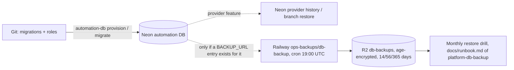

# 14 — Backup and DR

## ข้อมูลที่มี

| Data | ที่อยู่ | หมายเหตุ |
|---|---|---|
| `cron_jobs`, `automation_rules`, `workflow_pipelines`, `automation_log` | Neon project `platform-automation-api`, db `automation`, schema `automation` | 26 แถว import จาก SQLite เดิม (`PRODUCT.md`) |
| `create_keys`, `outbox` | schema เดียวกัน | outbox ว่างในเซลล์นี้ |
| `public.schema_migrations` | db เดียวกัน | name + sha256 ของ migration |
| Audit ของทุกการเขียน | empire-platform executions (นอก repo) | `before_hash` / `after_hash` เท่านั้น ไม่ใช่สำเนาข้อมูล |
| Schema | `migrations/0001_automation.sql`, `db/roles.sql` ใน Git | สร้างใหม่ได้ด้วย `automation-db provision` |

## Backup / restore reality

- Repo นี้ **ไม่มี** backup workflow ของตัวเอง
- ops record: prod-baseline-monitoring-backups (2026-11-03) — "The 30 Neon DBs are backed up by Railway `ops-backups/db-backup` (cron 19:00 UTC) using a per-project `db_backup` role" ไป R2 `db-backups` แบบ age-encrypted; รายชื่อ target อยู่ใน Railway variables `BACKUP_URL_<NAME>` (platform-db-backup `README.md`, `scripts/backup.sh`) จึง **ไม่สามารถยืนยันจากไฟล์ได้** ว่ามี `automation` อยู่ในชุดนี้
- `db/roles.sql` ของ repo นี้ไม่มี role `db_backup` (สร้างนอก repo ถ้ามี)
- Rebuild: `NEON_API_KEY=... automation-db provision` สร้าง project/roles แล้ว migrate; ข้อมูลต้อง restore จาก backup

## RTO / RPO

ไม่ได้กำหนด (not defined) ใน repo นี้หรือ `PRODUCT.md`

Sources: `PRODUCT.md`, `README.md`, `migrations/0001_automation.sql`, `db/roles.sql`, `src/cellkit/db.py`, ops record: prod-baseline-monitoring-backups (2026-11-03),
platform-db-backup@27a0a68 `README.md`, `scripts/backup.sh`

## Open questions

- `BACKUP_URL_AUTOMATION` (หรือชื่อใกล้เคียง) มีใน `ops-backups` หรือไม่? manifest ใน R2 มี `automation` หรือไม่
- RTO/RPO ที่ยอมรับได้ของ cell นี้
- Neon history retention ของ project นี้ (free plan) เท่าไร
