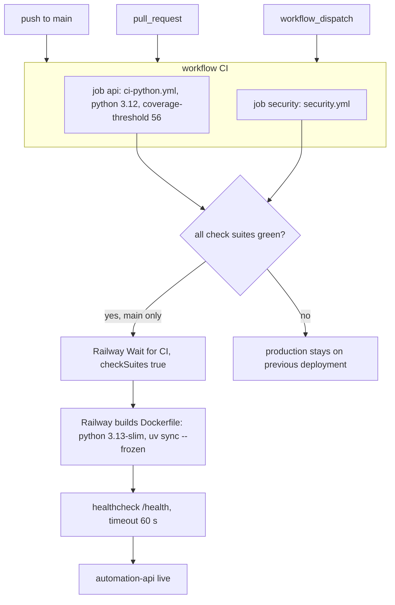

# 15 — CI/CD pipeline

Workflow เดียว: `.github/workflows/ci.yml` (name `CI`), GitHub-hosted runners (public repo), `permissions: contents: read`, concurrency `ci-${{ github.ref }}` cancel-in-progress
ทั้งสอง job เรียก reusable workflow ของ `bookchaowalit/platform-ci-workflows` pinned SHA `87dc5e1c…` (v1.1.1)

- Job `api` และ `security` ไม่มี `needs` ต่อกัน (รันขนาน)
- ขั้นตอนข้างใน reusable workflows (lint/mypy/pytest/scan) อยู่ใน repo `platform-ci-workflows` ไม่ได้อ่านใน pack นี้; README บอกว่า CI รัน `mypy`, `ruff check`, `ruff format --check` และ pytest
- Renovate (`renovate.json`): จันทร์ก่อน 9 โมง, lock maintenance วันที่ 1, group `platform-ci-workflows`, vulnerability alerts

Sources: `.github/workflows/ci.yml`, `.railway/railway.ts`, `Dockerfile`, `README.md`, `renovate.json`, `specs/001-l2-baseline/spec.md`
