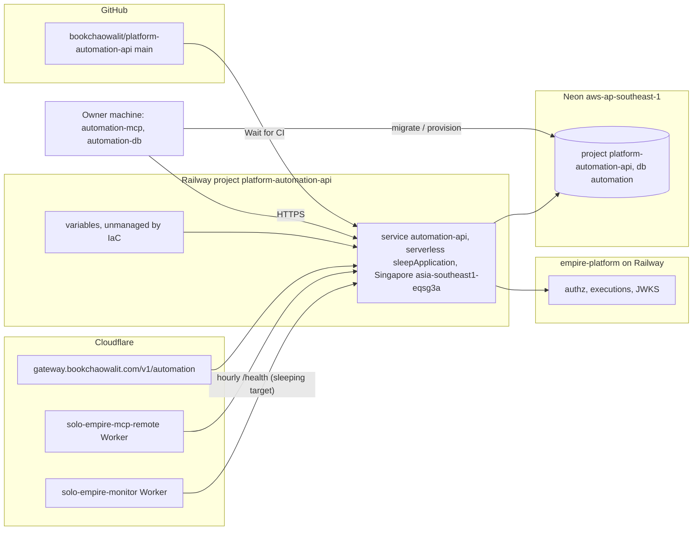

# 16 — Deployment

| Item | Value |
|---|---|
| Public URL | `https://automation-api-production-af8e.up.railway.app` (`/health`) |
| Gateway route | `automation` → URL ข้างบน (platform-api-gateway `routes.json`) |
| Image | `python:3.13-slim` + uv 0.13.1, user `cell` uid 10001, CMD `automation-api` |
| Port | `PORT` env, else `cell.yaml` port 3625; host `0.0.0.0` เมื่อ hosted |
| Variables (names) | `SENTRY_DSN`, `AUTOMATION_DB_MODE=hosted`, `AUTOMATION_DB_URL_API`, `AUTOMATION_JWT_PUBLIC_KEY_PEM`, `AUTOMATION_JWT_ISSUER`, `EMPIRE_PLATFORM_URL` (README); optional `AUTOMATION_JWT_JWKS_URL`, `AUTOMATION_PUBLISHER_TOKEN` (`server.py`) |
| Region | ตั้งด้วย `railway scale` (IaC ไม่เก็บ region) |
| GitHub environment | `platform-automation-api / production` (deployments API) |

Sources: `.railway/railway.ts`, `Dockerfile`, `README.md`, `PRODUCT.md`, `cell.yaml`, `src/cellkit/server.py`, `src/cellkit/db.py`,
platform-api-gateway@1f02c2a `routes.json`, platform-mcp-remote-worker@eb10b4d `src/worker.ts`, platform-uptime-worker@57f0afb `src/targets.ts`, `gh api repos/bookchaowalit/platform-automation-api/deployments`

## Open questions

- Custom domain สำหรับ cell นี้? ไม่พบ — ใช้ `*.up.railway.app` + gateway
