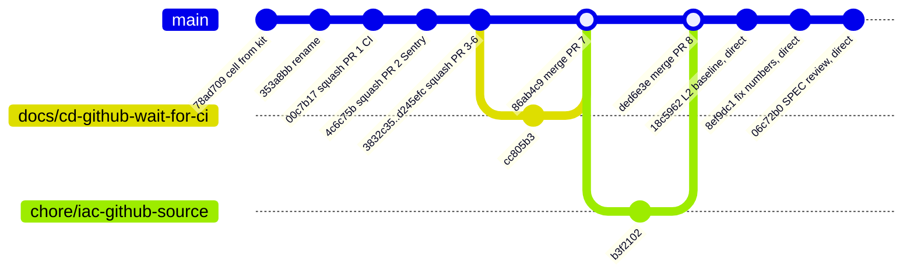
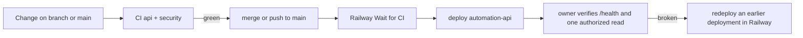

# 18 — Git and release workflow

จาก history: งานส่วนใหญ่ผ่าน short-lived branch + PR (#1–#8, 2026-10-17/18) แต่ Wave 2 (2026-10-22) และ SPEC review (2026-10-24) commit ตรงเข้า `main` (SPEC-001: "Main-only: yes")
ไม่มี tag หรือ GitHub release; version ใน `pyproject.toml` คงที่ `0.1.0`

PR #1–#6 เป็น squash commit บน `main` (subject ลงท้าย `(#n)`), PR #7–#8 เป็น merge commit ("Merge branch ...")

Sources: `git log origin/main`, `gh pr list -R bookchaowalit/platform-automation-api --state all`, `README.md`, `AGENTS.md`, `specs/001-l2-baseline/spec.md`, `.railway/railway.ts`, `pyproject.toml`
