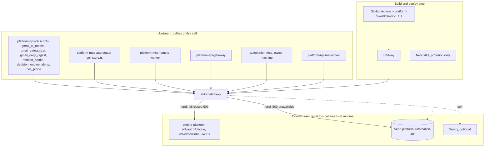

# 19 — Service dependency map

| Dependency | Type | ถ้าล่ม |
|---|---|---|
| empire-platform | hard, sync HTTP ทุก request ที่มี token | 503 `authorization_unavailable` (อ่านและเขียนไม่ได้) |
| Neon | hard | 503 `unavailable` (connect timeout 15 s) |
| JWKS endpoint | soft (cache + pinned PEM fallback) | ใช้ key เดิม |
| Sentry | soft | ไม่มีผลต่อ request |
| Tasks API | none (เก็บ id ใน `affected_tasks` ไม่เรียก) | — |

Sources: `src/cellkit/platform.py`, `src/cellkit/auth.py`, `src/cellkit/db.py`, `src/cellkit/app.py`, `src/cellkit/_sentry.py`, `.github/workflows/ci.yml`, `.railway/railway.ts`, `PRODUCT.md`,
platform-ops-cli@0880abe `infra/scripts/**` (ไฟล์ตามชื่อใน diagram), platform-mcp-remote-worker@eb10b4d `src/worker.ts`, platform-api-gateway@1f02c2a `routes.json`, platform-uptime-worker@57f0afb `src/targets.ts`,
solo-empire `repository-catalog/registries/online-systems.yaml` (`automation`, `client` field)
