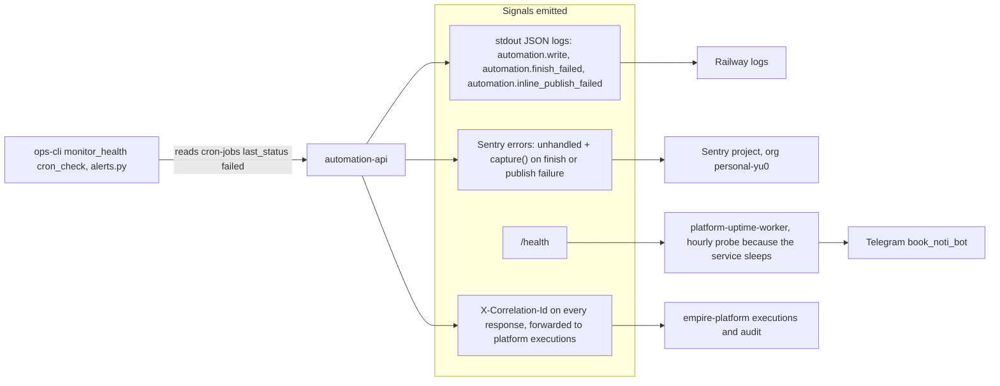

# 20 — Observability

| Watched | How | หลักฐาน |
|---|---|---|
| Up / down | uptime worker target `automation-api`, sleeping → probed hourly, alert Telegram | platform-uptime-worker `src/targets.ts`, ops record: prod-baseline-monitoring-backups |
| Errors | Sentry เมื่อ `SENTRY_DSN` ตั้งไว้; tracing off, ไม่มี PII | `src/cellkit/_sentry.py`, `README.md` |
| Writes / audit | execution ต่อการเขียน + JSON log | `src/cellkit/app.py` |
| Failed jobs (business signal) | ops-cli อ่าน `last_status=failed` | platform-ops-cli `alerts.py`, `monitor_health.py` |
| Metrics (latency, 5xx) | **ไม่มี** — `PRODUCT.md` Measures "Proposed (nothing collects these yet)" | `PRODUCT.md` |
| Heartbeat | ไม่มี (cell ไม่มี cron job ของตัวเอง) | `.railway/railway.ts` |

Sources: `src/cellkit/app.py`, `src/cellkit/_sentry.py`, `src/cellkit/publisher.py`, `README.md`, `PRODUCT.md`, `.railway/railway.ts`, platform-uptime-worker@57f0afb `src/targets.ts`, `src/monitor.ts`,
platform-ops-cli@0880abe `infra/scripts/utils/alerts.py`, `infra/scripts/platform/monitor_health.py`, ops record: prod-baseline-monitoring-backups (2026-11-03)

## Open questions

- `SENTRY_DSN` ตั้งใน Railway ของ service นี้แล้วหรือยัง (ops record บอก Sentry live บน 35 repos แต่ไม่ได้ระบุชื่อ cell นี้)
- ไม่มี dashboard ใดที่พบในไฟล์
