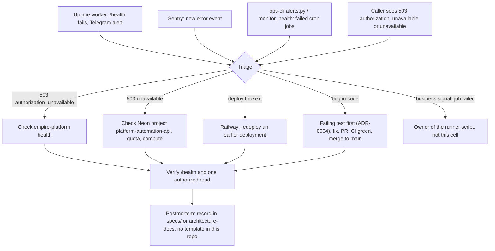

# 21 — Incident response

ไม่มี runbook ของ cell นี้ใน repo; flow ด้านล่างประกอบจาก alert channel และขั้น rollback/verify ที่พบจริง

Sources: `README.md` (rollback), `AGENTS.md` (verify after merge), `src/cellkit/app.py` (503 codes), `src/cellkit/_sentry.py`, `specs/001-l2-baseline/spec.md` (ADR-0004 test-first),
platform-uptime-worker@57f0afb `src/targets.ts`, platform-ops-cli@0880abe `infra/scripts/utils/alerts.py`, ops record: prod-baseline-monitoring-backups (2026-11-03), ops record: neon-platform-quota (2026-11-03)

## Open questions

- Postmortem อยู่ที่ไหน และมี template กลางหรือไม่
- Sentry alert rule ส่งไปช่องทางใด (Telegram/อีเมล) — ไม่พบในไฟล์
