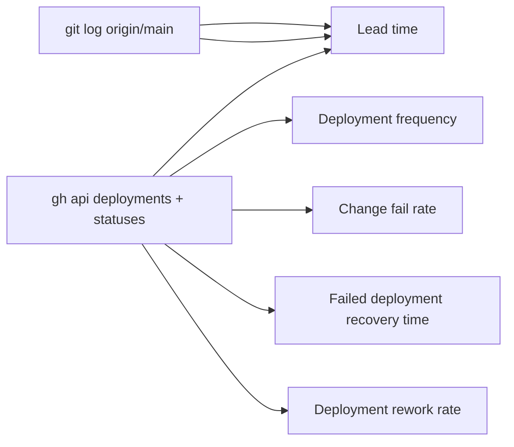

# 22 — DORA metrics

ช่วงวัด: 90 วันถึง 2026-11-04 (`--since=2026-08-06`) · repo เริ่ม 2026-10-10 จึงมีข้อมูลจริง ~25 วัน
Deployment = GitHub deployment ใน environment `platform-automation-api / production` ที่ Railway สร้าง (มีตั้งแต่ CD 2026-10-18); deploy แบบ `railway up` ก่อนหน้านั้นไม่มีบันทึกใน GitHub



| Metric | วิธีวัด | ค่า (90 วัน) |
|---|---|---|
| Deployment frequency | จำนวน deployment production | **4** deployments (2026-10-18 ×3, 2026-10-24 ×1) ≈ 1/week; + 1 redeploy SHA เดิม `06c72b0` 2026-10-30 |
| Lead time for changes | commit author time → status `success` ของ deployment แรกที่มี commit นั้น | 16 commits หลัง `00c7b17`: median ≈ **1.6 h**; ต่ำสุด 1 min (`ded6e3e`), สูงสุด ≈ 56 h (6 commits ของ 2026-10-22 รอจน `06c72b0` 2026-10-24) |
| Change fail rate | deployment ที่ตามด้วย revert / hotfix / status failure | **0 / 4** (ไม่มี status `failure`/`error`, ไม่มี commit revert) |
| Failed deployment recovery time | เวลาจาก deployment ล้มถึงกลับปกติ | **N/A** — ไม่มี deployment ล้มในช่วงนี้ |
| Deployment rework rate | deployment ที่ไม่ได้วางแผน เพื่อแก้ปัญหา production | **0 / 4** ที่ยืนยันได้; redeploy 2026-10-30 ของ `06c72b0` ไม่ทราบสาเหตุ (ดู open questions) |

หมายเหตุ lead time: 6 commits ของ 2026-10-22 (01:39–02:16 UTC) ไม่สร้าง deployment ทั้งที่ CI เขียว ซึ่งตรงกับช่วงที่ Railway Wait for CI ค้าง (ops record: railway-wait-for-ci-stuck, resolved 2026-10-22 09:23 UTC) จึงไปกับ deployment ถัดไปเท่านั้น
CI health ประกอบ: 23 runs, 1 failure (PR `fix/sentry-scrub` `3933318`, 2026-10-18) — ไม่กระทบ production

## Commands

```bash
# commits on main in the window
git log origin/main --since=2026-08-06 --first-parent --format='%h %aI %s'
# production deployments and their statuses
gh api repos/bookchaowalit/platform-automation-api/deployments --jq '.[] | "\(.created_at) \(.environment) \(.sha[0:7]) \(.id)"'
gh api repos/bookchaowalit/platform-automation-api/deployments/<id>/statuses --jq '.[] | "\(.created_at) \(.state)"'
# commits carried by each deployment (lead time)
git log --format='%h %aI' d245efc..86ab4c9   # then 86ab4c9..ded6e3e, ded6e3e..06c72b0
# CI runs, reverts
gh run list -R bookchaowalit/platform-automation-api -L 100 --json createdAt,event,headBranch,conclusion,headSha
git log origin/main --since=2026-08-06 -i --grep=revert --oneline | wc -l   # 0
```

ข้อมูลดิบ (deployment → success): `d245efc` 2026-10-18T09:39:45Z · `86ab4c9` 10:11:12Z · `ded6e3e` 14:03:54Z · `06c72b0` 2026-10-24T10:05:36Z (redeploy success 2026-10-30T18:50:47Z)
Lead time ของ 5 commits ก่อน `d245efc` (PR #2–#6) วัดถึง deployment แรกบน GitHub source ซึ่งอาจเกินจริง เพราะช่วงนั้นอาจยัง deploy ด้วย `railway up`

Sources: `git log origin/main`, `gh api repos/bookchaowalit/platform-automation-api/deployments`, `gh run list -R bookchaowalit/platform-automation-api`, `README.md` (CD since 2026-10-18), ops record: railway-wait-for-ci-stuck (2026-11-03)

## Open questions

- Redeploy 2026-10-30 (`06c72b0`, in_progress 18:47 → success 18:50 UTC; มี status `inactive` 2026-10-29 17:13) เกิดจากอะไร — restart, variable change หรือ deploy approval gate (ops record: railway-deploy-approval-gate)?
- Railway deployment history ก่อน 2026-10-18 (`railway up`) ไม่ได้นับ
